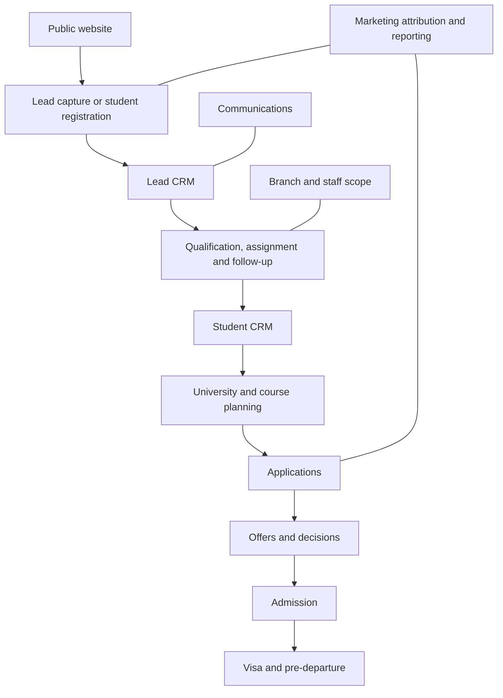

# Module architecture

## Status and interpretation

This is a **Target UI** information architecture baseline, not an immutable backend schema or evidence of completed modules. Known capabilities are supplied product context from [Product Context](PRODUCT_CONTEXT.md). Sprint 2.1 implements the shared shell on the three existing role routes; module routes and real dashboard content remain unimplemented.

## Domain map

| Domain | Target module coverage | Known anchors and boundary |
| --- | --- | --- |
| Dashboard | Role-specific overview and attention | Existing Admin metrics inform redesign; future role views differ |
| CRM & Students | Leads, Students, Counsellors, Follow-ups, Communications | Advanced lead workflow is known; Client/Clients labels need semantic mapping; communications is developing |
| Admissions | Applications, Universities & Courses, Offers & Decisions, Visa Management | Course Finder is known; broader journey modules are target architecture, not verified completion |
| Operations | Branches, Sub-Branches, Staff & Roles, Meetings & Appointments, Tasks & Approvals | Branches, Team, Task and Appointments are known anchors; sub-branches and broader approvals remain planned concepts |
| Content & Marketing | Website CMS, Events, Blog & Resources, Media Library, Homepage/Hero management where applicable, Study Abroad content, Marketing Tools, campaign/attribution concepts | Existing content/marketing tools should be preserved and reorganized |
| Finance | Accounts, Invoices, Commissions, Payments | Accounts/Finance and legacy payment-domain revenue exist in supplied context; exact new module coverage is unverified |
| Reports & Analytics | Analytics & Reports, Website/Marketing Analytics, Branch Performance, Export & Data Tools | Website/marketing metrics and branch revenue are known; reporting/export structure is planned |
| Administration | Settings, System & Security, Roles & Permissions, Audit Logs, Provider/Integration Settings, Help & Support | Settings and support are known; expanded administration is a target, not a backend claim |

Roles & Permissions may be reached through staff workflows and administration without duplicating the authority model. Tasks & Approvals is an Operations concept even though it has no standalone entry in the initial sidebar baseline. Website/marketing analytics and branch performance may be report subsections rather than additional top-level modules.

## Lifecycle and relationships

This describes the conceptual journey, not mandatory database transitions. In particular, registration routing and conversion criteria must be confirmed rather than inferred from arrows.

| Relationship | UI implication | Contract still to confirm |
| --- | --- | --- |
| Lead, assigned counsellor and branch | Show accountable ownership and visible scope | Reassignment rules and cross-branch access |
| Lead and follow-up records | Preserve scheduling, completion and rescheduling context | Exact state transitions and concurrency contract |
| Lead and student | Distinguish acquisition from ongoing consultancy | Conversion/registration identity and deduplication |
| Student and applications | A student may have multiple applications | Status vocabulary, identifiers and aggregation |
| Application, university/program, offer/decision and admission | Preserve application-level progression | Offer/admission cardinality and confirmation rules |
| Lead selection and communications | Reuse lead filters, eligibility and recipient scope | Provider contracts and delivery states |
| Branch and staff/queues/performance | Support scoped operations and authorized aggregation | Metric ownership and permission matrix |
| Events/content/campaigns and conversions | Connect acquisition to operations where attribution exists | Attribution model and conversion definitions |
| Finance and operational records | Link appropriate financial summaries without confusing payment and admission counts | Currency, recognition rules and finance access |

Notifications and auditability span domain actions. They do not replace the underlying follow-up, application, approval or communication record.

## Planned Admin navigation baseline

Labels below are future sidebar organization, not routes to implement now:

- Dashboard
- **CRM & STUDENTS:** Leads; Students; Counsellors; Follow-ups; Communications.
- **ADMISSIONS:** Applications; Universities & Courses; Offers & Decisions; Visa Management.
- **OPERATIONS:** Branches; Sub-Branches; Staff & Roles; Meetings & Appointments.
- **CONTENT & MARKETING:** Website CMS; Events; Blog & Resources; Media Library; Marketing Tools.
- **FINANCE:** Accounts; Invoices; Commissions; Payments.
- **REPORTS & ANALYTICS:** Analytics & Reports; Export & Data Tools.
- **ADMINISTRATION:** Settings; System & Security; Audit Logs; Help & Support.

## Preserve existing functionality during reorganization

The supplied current sidebar has Dashboard; CRM: Leads, Client, Task, Team; Operations: Branches, Scholarships, Course Finder, Appointments; Marketing: Marketing, Events, Media Library, Homepage Hero, Study Abroad, Marketing Tools; Finance: Accounts, Finance; System & Other: Agreements, Chat with Support, Blog, Settings.

Do not delete capabilities simply because the target baseline uses fewer labels. Course Finder may map to Universities & Courses; Appointments to Meetings & Appointments; Homepage Hero and Study Abroad content to Website CMS; Blog to Blog & Resources; Chat with Support to Help & Support. These are candidate placements requiring capability review. Scholarships and Agreements remain explicitly preserved but placement is unresolved. Marketing, Finance, Task, Team and Client require finer mapping before replacement; see [Terminology](TERMINOLOGY.md).

## Frontend responsibility boundaries

| Location | Responsibility |
| --- | --- |
| `src/main.jsx` | React bootstrap, global stylesheet import and mount |
| `src/App.jsx` | Application-level composition, not dashboard business markup |
| `src/app/` | Route configuration and future application composition |
| `src/assets/` | Shared visual assets |
| `src/components/ui/` | Reusable primitives |
| `src/components/layout/` | Shared layout building blocks |
| `src/components/dashboard/` | Domain-aware dashboard components |
| `src/data/` | Explicit synthetic mock data, separate from presentation |
| `src/hooks/` | Reusable behavior when needed |
| `src/layouts/` | Role-aware page/layout composition |
| `src/pages/admin/`, `counsellor/`, `student/` | Distinct role page composition |
| `src/styles/` | Global styles and future token foundation |
| `src/utils/` | Focused shared utilities |

Potential later primitives: Button, IconButton, Card, Badge, StatusBadge, Avatar, SearchInput, Select, Dropdown, Tooltip, SectionHeader, EmptyState, Skeleton and TableContainer. Potential shared layout concepts: DashboardLayout, Sidebar, MobileSidebar, Topbar and PageContainer. These are future components, not Sprint 0.2 additions.

Introduce `config/`, `services/` or `features/` only when demonstrated complexity justifies them. Do not prebuild state management, backend adapters or authentication. Preserve simple data/presentation boundaries for eventual integration; [Working Rules](CODEX_WORKING_RULES.md) govern implementation scope.

## Implemented shared shell — Sprint 2.1

`DashboardLayout` supplies role configuration and fictional profile defaults to one `DashboardShell`. Admin, Counsellor and Student page components provide their own title/description and neutral ShellPreview content. The shell owns Sidebar, Topbar, MobileNavigation, PageHeader and a fluid semantic main workspace. It does not import role-specific business components. The root Foundation Preview remains outside this shell.

`src/config/dashboardNavigation.js` owns lightweight groups/items, named icon references, destinations, optional badges and disabled states. Admin preserves the supplied existing navigation vocabulary (including Client, Task, Team, Scholarships and Agreements). Counsellor uses documented daily-work concepts; Student uses journey concepts. Future items have no destinations and render unavailable; only Dashboard and the separate Foundation link navigate. This neither deletes legacy capabilities nor invents permissions or dozens of module routes.

`src/data/shellUsers.js` contains three fictional identities. Future integration can supply user/navigation inputs explicitly; no account fetching or authorization is implied by a role prop. `src/styles/shell.css` holds shell-specific geometry while sizing/layer values live in the existing token source. See [Design System](DESIGN_SYSTEM.md#sprint-21--shared-dashboard-shell) for responsive and accessibility behavior.
